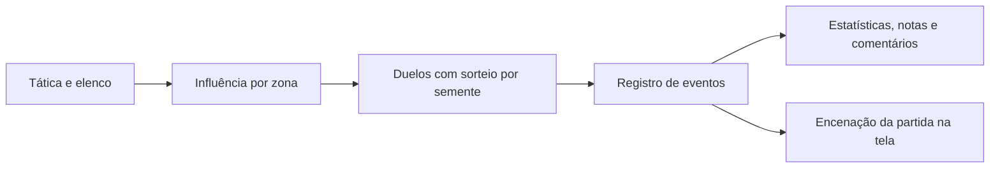
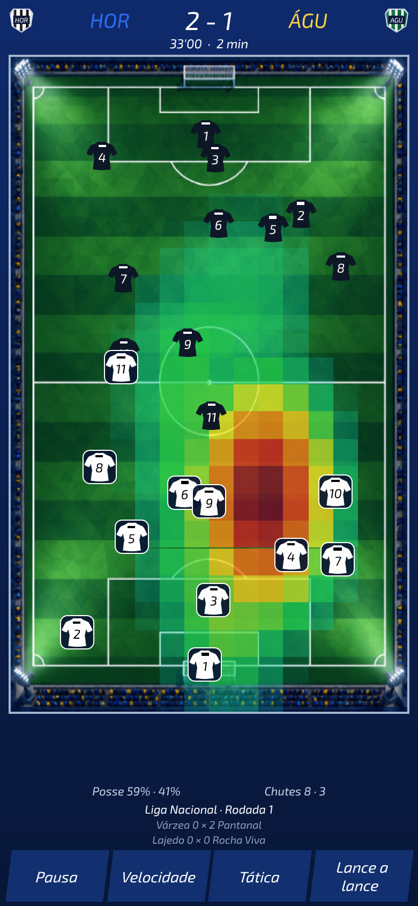
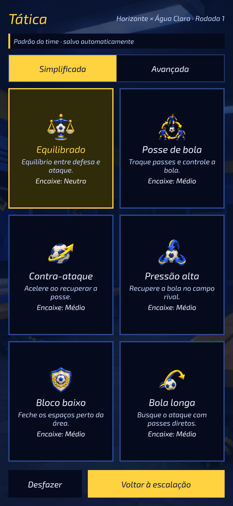
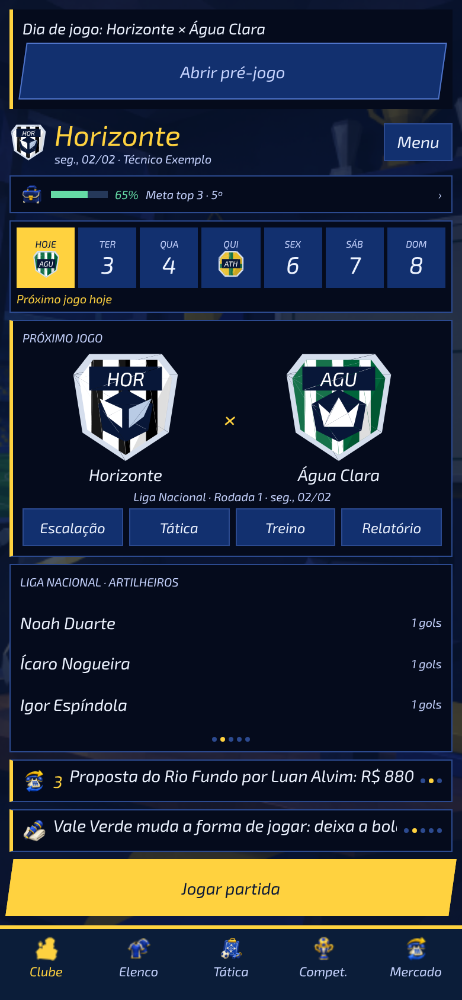
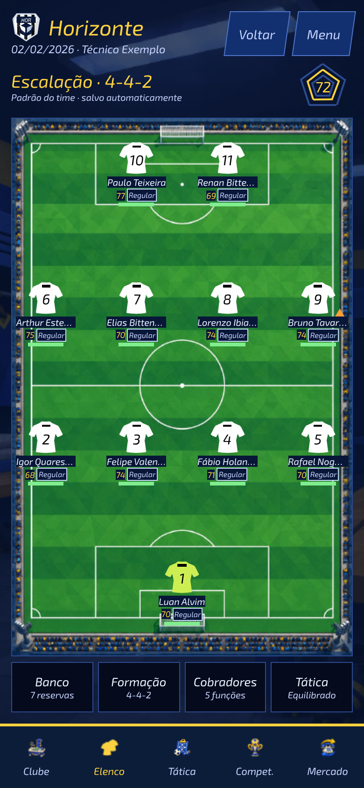
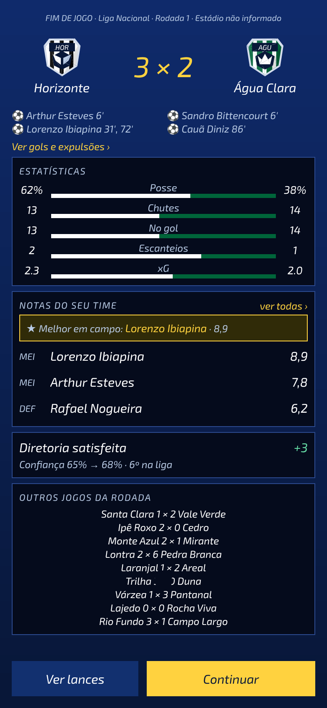

# Clubista

Jogo de gerenciamento de futebol para celular, em que o jogador é um técnico que monta o time, escolhe a tática e acompanha as partidas.

## A ideia

O Clubista segue a linha dos jogos de gerenciamento de futebol dos anos 2000, com o Brasfoot como principal inspiração. O jogador é um técnico que constrói a carreira passando por clubes de várias ligas: monta o elenco, negocia no mercado, cuida das finanças e da comissão técnica, treina o time e responde à diretoria.

A diferença está na profundidade tática. Escolher o estilo, a formação e os jogadores muda o que acontece em campo, sem bônus escondidos. O jogo mostra por quê, nas estatísticas, nos comentários da comissão técnica e no relatório do adversário. Tudo isso continua simples de jogar no celular.

## Estado atual

Protótipo testado em celular Android. Já é jogável:

- carreira de técnico com 16 ligas e copas;
- escalação, formações, tática simplificada e avançada, e treino;
- mercado com negociação em etapas, finanças e comissão técnica;
- partida com intervenções no intervalo e nas lesões, e resumo de fim de jogo;
- salvamento da carreira.

Ainda não existe: renovação, venda e empréstimo de jogadores do próprio elenco (os botões estão na tela, sem função), moral do elenco, seleções nacionais e publicação em loja.

## Como funciona o motor

- **Determinismo:** cada partida usa um gerador aleatório com semente. Mesma semente e mesmas escolhas produzem o mesmo jogo, o que permite testar e medir.
- **Da tática ao resultado:** o campo é dividido em zonas, e cada jogador exerce influência sobre elas conforme a formação, o papel e as instruções. Cada lance é um duelo na zona da bola. O estilo muda pressão, passe e transição, e o efeito é multiplicado pelo encaixe entre o estilo e os atributos dos titulares.
- **Aleatoriedade:** tática e elenco deslocam probabilidades, nunca garantem o resultado. Um confronto de estilos favorável é vantagem, não vitória certa.
- **Explicação:** a partida gera um registro completo de eventos. Desse registro saem as estatísticas, o lance a lance, as notas dos jogadores e os comentários da comissão, que citam setor, jogadores e o que fazer.

## Como foi construído

Eu defino o produto e conduzo o desenvolvimento. Parte do trabalho é executada por agentes de IA dentro do [ODP](https://github.com/AndreLSPortella/odp), um orquestrador que roda uma fila de tarefas. Cada tarefa é implementada numa cópia isolada do repositório, passa por build e testes automáticos e por dois revisores, e só então entra no ramo principal.

As decisões de design são discutidas antes de virar tarefa. As telas são aprovadas em protótipo. Os princípios do motor ficam registrados num arquivo de regras do projeto, e cada decisão de produto fica num registro de contexto com a data.

## Números

- Período: de 17/10/2026 a 13/11/2026, com 450 commits.
- 116 tarefas concluídas pelo ODP, todas aprovadas e mescladas a partir de 22/10.
- 1.198 testes automatizados aprovados, em 158 arquivos de teste.
- 20 telas.

## Capturas de tela

Universo de teste com clubes, jogadores e competições de nomes fictícios.

| Partida | Tática | Clube | Escalação | Fim de jogo |
|---|---|---|---|---|
|  |  |  |  |  |

## Decisões relevantes

1. **Toda consequência tática aparece para o jogador.** Se não dá para explicar por que uma escolha funcionou, ela não serve para aprender.
2. **Respostas emergem do motor, sem bônus por "resposta certa".** A única exceção é uma tabela suave de confronto entre estilos, sempre multiplicada pelo encaixe do elenco. Assim, a solução vem de como o jogo é simulado, e não de uma regra escondida.
3. **Toda decisão tem custo e nenhum estilo domina.** Pressão alta gasta fôlego, linha alta expõe as costas. Isso foi verificado em simulação: nenhum estilo é o melhor contra todos.
4. **Peso tático com meta medida.** Entre a melhor e a pior escolha de estilo, a diferença fica entre 10 e 15 pontos percentuais de vitórias, sem que um favorito claro caia abaixo de 50%. Assim, a tática importa sem anular a qualidade do elenco.
5. **Motor separado da apresentação.** O motor calcula a partida inteira, e a tela encena o resultado em 30 s a 3 min, sem alterar o jogo. Isso mantém a simulação testável e a tela no ritmo do jogador.

## Tecnologia

TypeScript; Expo SDK 55, React Native 0.83 e React 19 no app; Vitest nos testes; monorepo com npm workspaces (motor, mundo e app); build Android local.

## Sobre o código

O repositório do projeto é privado; este repositório é a vitrine pública.
